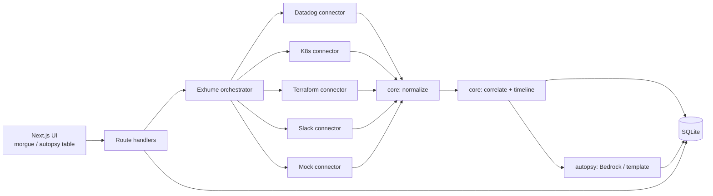

# Design Document — Necro-Ops MVP

## Overview
A pnpm monorepo with a Next.js app and four packages. Collection, normalization and correlation are separated so each connector is a thin adapter and all intelligence lives in pure, testable `core` functions. The LLM is used only for the final narrative and must cite evidence ids produced by `core`.

## Architecture



### Request flow
1. `POST /api/incidents` → create incident.
2. `POST /api/incidents/:id/exhume` → orchestrator runs connectors with `Promise.allSettled` + per-connector timeout; streams progress via Server-Sent Events (`GET /api/incidents/:id/exhume/stream`).
3. Normalized events stored; `core.buildTimeline()` produces clusters + suspected trigger; stored.
4. `POST /api/incidents/:id/autopsy` → `autopsy.generate()` → stored as draft report.
5. `PUT /api/incidents/:id/report` → save edits. `GET /api/incidents/:id/report.md` → export.

## Components and Interfaces

### Connector interface (`packages/connectors`)
```ts
export interface CollectWindow {
  start: Date;          // already padded
  end: Date;
  services: string[];
}

export interface Connector {
  id: 'datadog' | 'k8s' | 'terraform' | 'slack' | 'mock';
  isEnabled(env: NodeJS.ProcessEnv): boolean;
  collect(window: CollectWindow, signal: AbortSignal): Promise<RawItem[]>;
  normalize(item: RawItem): TimelineEvent | null; // null = drop
}
```

### Core domain types (`packages/core`)
```ts
type Source = 'datadog' | 'k8s' | 'terraform' | 'slack' | 'mock';
type EventKind = 'alert' | 'metric_anomaly' | 'log' | 'k8s_event'
               | 'deploy' | 'infra_change' | 'chat' | 'recovery';
type Severity = 'info' | 'warning' | 'critical';

interface Entity { type: 'service' | 'namespace' | 'pod' | 'resource'; name: string }

interface TimelineEvent {
  id: string;              // `${source}:${nativeId}`
  source: Source;
  timestamp: string;       // UTC ISO-8601
  kind: EventKind;
  severity: Severity;
  entities: Entity[];
  summary: string;         // <= 200 chars, redacted
  link?: string;
  raw: unknown;            // never exported
}

interface Cluster { id: string; eventIds: string[]; entities: Entity[]; start: string; end: string }

interface Timeline {
  events: TimelineEvent[];      // sorted
  clusters: Cluster[];
  suspectedTriggerId?: string;
}
```

### Core functions
- `dedupe(events): TimelineEvent[]`
- `buildTimeline(events, { gapMinutes = 5 }): Timeline`
  - Sort by timestamp → union-find grouping on (shared entity AND gap ≤ threshold).
- `findSuspectedTrigger(events): string | undefined`
  - First critical alert = T. Candidate = latest event with kind in {deploy, infra_change} before T sharing an entity with T; else the latest change before T.
- `redact(text): string` — regex set for AWS keys, bearer tokens, `password=`, emails, JWTs.

### Autopsy (`packages/autopsy`)
- `generate(incident, timeline, opts): Promise<Report>`
- Prompt input: incident meta + condensed timeline (id, time, source, kind, severity, summary) + suspected trigger. Raw payloads are never sent.
- Output schema (zod):
```ts
const ReportSchema = z.object({
  summary: z.string(),
  causeOfDeath: z.array(z.object({ text: z.string(), citations: z.array(z.string()).min(1) })),
  contributingFactors: z.array(z.object({ text: z.string(), citations: z.array(z.string()).min(1) })),
  impact: z.string(),
  detectionAndResponse: z.string(),
  actionItems: z.array(z.object({ title: z.string(), type: z.enum(['prevent','detect','mitigate']), priority: z.enum(['P1','P2','P3']) })),
});
```
- Validation also checks every citation id exists in the timeline.
- Retry once on failure, then `templateReport(timeline)`.
- Model id configurable via `BEDROCK_MODEL_ID`; region via `AWS_REGION`.

## Data Models (Drizzle / SQLite)
- `incidents(id, title, start_at, end_at, services_json, status, created_at)`
  - status: `pending | exhuming | exhumed | autopsied | failed`
- `connector_runs(id, incident_id, connector, status, error, started_at, finished_at, item_count)`
- `events(id, incident_id, source, ts, kind, severity, entities_json, summary, link, raw_json)`
- `timelines(incident_id, clusters_json, suspected_trigger_id, built_at)`
- `reports(incident_id, body_json, is_draft, generated_by, updated_at)` — `generated_by`: `bedrock | template | user`

## UI
- `/morgue` — incident cards as "tombstones" (title, date, status, services). "New incident" form.
- `/incidents/[id]` — three panes:
  1. Exhume panel: per-connector status chips (SSE).
  2. Timeline: vertical timeline, color by source, clusters drawn as stitched seams; suspected trigger marked with a ⚡ "spark of life" badge; filters.
  3. Report: rendered sections, citation chips scroll to events, edit mode, Export button.
- Theme: dark palette, accent "formaldehyde green" and "stitch red"; all tokens checked for AA contrast. Reduced-motion disables flicker/glow animations.

## Error Handling
- Connector errors are isolated (`allSettled`) and surfaced in the Exhume panel.
- Zod failures at boundaries return 400 with field messages.
- LLM failures fall back to template; the report shows which generator was used.

## Testing Strategy
- Unit (Vitest): normalizers per connector with fixture payloads; `dedupe`, `buildTimeline`, `findSuspectedTrigger`, `redact`; report schema + citation validation.
- Golden tests: each mock scenario → expected suspected trigger and cluster count.
- E2E (Playwright): demo mode → open scenario (a) → Exhume → Perform Autopsy (template) → Export Markdown contains "Cause of Death".
