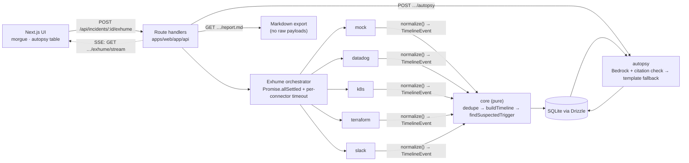

# ☠ Necro-Ops — The Incident Morgue

> Perform an **autopsy** on dead (resolved) production incidents. Necro-Ops stitches
> together signals from monitoring, Kubernetes, infrastructure-as-code, and team chat
> into one correlated timeline, then writes a blameless postmortem automatically.

Built for **Kiroween 2026** · Category: **Frankenstein** (stitching incompatible tools into one app)

---

## Why

After an incident, the evidence is scattered: alerts in Datadog, pod events in
Kubernetes, the recent `terraform apply` in CI logs, and the human conversation in
Slack. Reconstructing "what happened when" takes hours — and is often skipped.

Necro-Ops does it in three moves:

1. **Exhume** — pull every signal for an incident window from each source, in parallel.
2. **Stitch** — normalize and correlate them into one chronological timeline, cluster
   related events, and flag the **suspected trigger** (e.g. the deploy 8 minutes before
   the first page).
3. **Autopsy** — generate an evidence-backed, blameless postmortem: cause of death,
   contributing factors, timeline, impact, detection & response, and action items.

Every statement in the report links back to the actual event that supports it.

---

## Quickstart (demo mode — no credentials needed)

Judges can run the full experience with **zero configuration**. Three realistic mock
scenarios are auto-seeded into a local SQLite file on first launch.

```bash
# 1. Install dependencies (requires Node 22+ and pnpm 9+)
pnpm install

# 2. Start the app in demo mode
pnpm dev

# 3. Open the Morgue
open http://localhost:3000/morgue
```

That's it. The three seeded incidents are ready to exhume and autopsy:

| Scenario | What happened |
|---|---|
| **OOMKilled** | A Terraform change scaled replicas without raising the memory limit → pods OOMKill |
| **Expired TLS cert** | A certificate expired on schedule → 5xx storm, no change event (tests the "no trigger" path) |
| **Bad deploy + rollback** | A null-check bug shipped in v2.5.0 → NPE spike → Slack discussion → rollback |

### Try the flow

1. Open an incident from the Morgue.
2. Click **Exhume** — watch per-connector progress stream in live (SSE).
3. See the **stitched timeline** with the ⚡ suspected-trigger badge; filter by source / severity.
4. Click **Perform Autopsy** — a report is generated (template generator in demo mode).
5. Citations in the report are clickable — they scroll to the cited event.
6. Click **Export .md** to download the postmortem as Markdown.

---

## Architecture



Connectors only collect and normalize. All correlation lives in `packages/core` as pure
functions, so the same timeline logic runs on mock data and on real data.

### Monorepo layout

```
necro-ops/
├─ apps/web/            # Next.js app (UI + API route handlers) + Playwright e2e
├─ packages/
│  ├─ core/             # domain types, redact, dedupe, buildTimeline, findSuspectedTrigger (pure)
│  ├─ connectors/       # shared Connector interface: mock, datadog, k8s, terraform, slack
│  ├─ autopsy/          # templateReport + Bedrock generate() (prompts/ versioned)
│  └─ db/               # Drizzle schema, migrations, queries, demo seed
├─ fixtures/scenarios/  # the three mock incidents
├─ scripts/             # kiro-task.sh / kiro-all.sh: run spec tasks headless with Kiro CLI
└─ .kiro/               # Kiro steering, specs, custom agent
```

**Dependency direction:** `apps/web → autopsy → core ← connectors`; `db` is used only by `apps/web`. `core` imports from no other package and is fully deterministic.

---

## Tech stack

- **TypeScript** (strict) everywhere, Node 22, **pnpm** workspaces
- **Next.js** App Router + React Server Components, **Tailwind CSS**
- **zod** at every external boundary
- **SQLite** via **Drizzle ORM** (single file — zero ops for judges)
- **Amazon Bedrock** (Anthropic Claude) for the narrative, with a deterministic
  template fallback when Bedrock isn't configured
- **Vitest** (unit) + **Playwright** (one end-to-end demo flow)

---

## Going live (optional)

Copy `.env.example` to `.env` and set `NECRO_MODE=live`. Each real connector runs only
when its own variables are present; otherwise it shows as `skipped`.

| Connector | Variables | Reads |
|---|---|---|
| Datadog | `DATADOG_API_KEY`, `DATADOG_APP_KEY` (optional `DATADOG_SITE`) | events + monitors in the window |
| Kubernetes | `KUBECONFIG` | events + pod status for the services |
| Terraform | `TERRAFORM_SHOW_JSON_PATH` and/or `TERRAFORM_APPLY_LOG_PATH` | `terraform show -json` output + CI apply log |
| Slack | `SLACK_BOT_TOKEN`, `SLACK_CHANNEL_ID` | channel history (redacted; mentions and user ids replaced) |
| Bedrock | `AWS_ACCESS_KEY_ID`, `AWS_SECRET_ACCESS_KEY`, `AWS_REGION`, `BEDROCK_MODEL_ID` | LLM narrative; template fallback without it |

Collection windows are padded by `WINDOW_PAD_BEFORE` / `WINDOW_PAD_AFTER` minutes
(default 30 / 15). The SQLite file path is `DATABASE_URL` (default `./necro-ops.db`).

All connectors are **read-only** — Necro-Ops never writes to or mutates external systems.

### Security & privacy

- Credentials are read only from environment variables; never persisted or logged.
- Evidence is **redacted** (API keys, tokens, passwords, emails, JWTs) before it ever
  reaches the LLM.
- Raw payloads are stored but **never** included in the exported Markdown.

---

## Commands

| Command | What it does |
|---|---|
| `pnpm dev` | Run the web app in demo mode |
| `pnpm test` | Unit tests (Vitest): 426 tests in 21 files across core, connectors, autopsy, db, web |
| `pnpm e2e` | End-to-end demo flow (Playwright) |
| `pnpm seed` | Load the mock scenarios into SQLite manually |
| `pnpm build` | Production build of the web app |
| `pnpm lint` | ESLint |

---

## How Kiro was used

This project was built spec-first with Kiro:

- **Specs** (`.kiro/specs/necro-ops-mvp/`) — `requirements.md` (EARS acceptance
  criteria), `design.md` (architecture, interfaces, data model), and `tasks.md` (a
  numbered implementation plan). Each task references the requirement IDs it satisfies,
  and tasks were implemented and checked off one at a time.
- **Steering** (`.kiro/steering/`) — always-on context for the agent: `product.md`
  (vision, scope, principles), `tech.md` (stack, conventions, the read-only connector
  rule, "LLM output must be zod-parsed, retry once, then fall back to template"), and
  `structure.md` (repo layout and dependency direction). These kept generated code
  consistent with the intended architecture across every task.
- **Custom agent** (`.kiro/agents/necro-builder.json`) — an implementation agent scoped
  to the steering files and the spec. It does exactly one task per session: read the
  requirements and design, implement only that task, write and run tests, then check
  the box in `tasks.md`.
- **Headless task runner** (`scripts/kiro-task.sh <task-id>`) — runs one task through
  the `necro-builder` agent with Kiro CLI, requires a clean tree so each task becomes one
  reviewable commit, logs to `.kiro/logs/`, and commits only if the task got checked off.
  `scripts/kiro-all.sh` chains them.
- **No hooks.** This repo does not use Kiro agent hooks; the task-runner scripts above
  play that role.
- **Determinism as a design constraint** — correlation (`buildTimeline`,
  `findSuspectedTrigger`) and the template report are pure functions, locked in with
  **golden tests** so the demo is reproducible.

---

## Out of scope (hackathon)

- Real-time alerting or paging.
- Any write action against an external system (no remediation, no posting to Slack).
- Multi-tenant auth / RBAC.

---

## License

[MIT](LICENSE)
